# Cailloux et objets

Bienvenue dans mon économie. Les **cailloux**, c'est ma monnaie. On en gagne en travaillant pour moi, en passant chaque jour, en jouant, et un peu rien qu'en étant là. On les dépense en nourriture pour son Plynling, en objets de collection, en cosmétiques… ou en pots-de-vin. Je ne juge pas. Enfin, si, mais je prends l'argent (ᵔ ᗜ ᵔ)

## Gagner des cailloux

| Comment | Combien |
|---|---|
| `/work` | 25 à 40, toutes les 4 h |
| `/daily` | de 5 à 100 selon ta série, parfois un objet en plus |
| Parler, réagir, être en vocal | 1 par gain d'XP, une trentaine par jour au plus |
| Le [quiz](quiz.md) | 25, 40 ou 60 à la première personne qui trouve, 150 pour la grosse tête de la semaine |
| L'[arcade](arcade.md) et Quokka | selon le jeu |
| Compléter une collection | sa récompense (voir [plus bas](#le-carnet-de-collection)) |
| Revendre des objets | voir [`/inventory sell`](#inventory-sell) |
| Les aventures de ton [Plynling](plynlings/index.md), les tirages au sort, ce qu'on te donne | ça dépend |

### `/work`

Un petit boulot pour moi, payé **25 à 40 cailloux**, une fois toutes les **4 heures**. Raccourci : tape `;work` dans un salon.

Si tu reviens un tout petit peu trop tôt (moins de 5 minutes avant la fin de l'attente), je te paie quand même, en râlant, **une fois par jour**. Ça avance juste ton prochain `/work` d'autant : ça ne fait pas un boulot de plus.

### `/daily`

Ta récompense du jour, à prendre **une fois par jour** (minuit, heure de Paris). Elle grandit avec ta **série** de jours d'affilée : environ 10 cailloux le premier jour, puis à peu près 5 de plus chaque jour, avec un peu de hasard, jusqu'à **100** au maximum. Et parfois un **objet** en prime : 10 % de chances le premier jour, 2 % de plus par jour de série, jusqu'à 60 %.

Sauter un jour remet ta série à 1. Sauf si c'est ma faute : un jour où j'ai été hors ligne au moins 3 heures ne casse pas ta série. Ta meilleure série compte pour le succès **🔥 Assiduité** (voir [les niveaux](niveaux.md#les-succes)). Raccourci : `;daily`.

!!! syncs jenote ""
    Reviens demain. Et après-demain. Je compte les jours, moi aussi.

### `/balance`

Tes cailloux, **visibles par toi uniquement**. Le bouton 🔔 t'envoie un message privé dès que ton prochain `/work` est prêt (un message par boulot) ; reclique pour l'arrêter.

### `/pay`

Donne des cailloux à quelqu'un.

- **`member`** : qui les reçoit ;
- **`amount`** : combien, de 10 à 2 000.

Une **taxe de 10 %** (arrondie au-dessus) s'ajoute, **à ta charge** : la personne reçoit exactement ce que tu as tapé, et la taxe disparaît, personne ne la touche. Tu peux envoyer **2 000 cailloux par jour** au plus, toutes personnes confondues. Pas à toi-même, ni à un bot.

!!! syncs sulk ""
    La taxe, personne ne la touche. Même pas moi. Et pourtant, j'ai demandé.

## Ce que les cailloux m'achètent

### `/bribe favourite`

**24 heures de traitement de faveur** : je suis gentille avec toi. Pour une fois. Racheter prolonge de 24 h à partir de la fin.

### `/bribe shame`

J'efface **un** de tes points sur le [mur de la honte](honte.md).

- **`category`** : dans quel titre (Malfaisant, Banni, Perfide, Hystérique ou Indigne).

Pour le Banni, j'efface un vote du staff. S'il n'y a rien à effacer dans ce titre, je refuse et tu ne paies rien.

!!! warning "Le prix des pots-de-vin"
    Un pot-de-vin coûte **100 cailloux**, et le prix **double** à chaque pot-de-vin que tu as déjà payé cette semaine (du lundi au dimanche), les deux sortes confondues : 100, puis 200, puis 400… Lundi, on repart à 100.

!!! syncs bargain ""
    Un pot-de-vin, ça va. Trois dans la semaine, ça devient une relation. Je facture en conséquence ♡

### `/shoutout bid`

Une enchère pour une **dédicace dans mon bonjour du matin**. Ne marche que sur mon serveur principal, là où je dis bonjour.

- **`amount`** : ta mise, **50** au minimum pour ouvrir, puis au moins **10 de plus** que la meilleure mise.

Avant **20 h**, tu enchéris pour le bonjour de demain ; à partir de 20 h, pour celui d'après-demain. Ta mise est prise tout de suite ; si quelqu'un te dépasse, elle te revient. Si tu relances alors que tu mènes déjà, tu ne paies que la différence.

`/shoutout status` montre où en sont les enchères.

### `/jar give`

Le **bocal** du serveur : tout le monde y verse, tout le monde en profite.

- **`amount`** : combien verser, de 10 à 100 000.

Chaque **objectif** atteint débloque une récompense pour tout le serveur. Le premier est à 1 500 cailloux, chaque suivant demande 500 de plus, jusqu'à 5 000 au maximum. Ce qui dépasse compte pour l'objectif suivant, donc un gros don peut en débloquer plusieurs. Les récompenses tournent dans cet ordre :

1. **`/daily` double** pour tout le monde, le lendemain ;
2. **Festin** : une truffe pour chaque Plynling vivant (pas ceux qui sont gelés) ;
3. **Giveaway** : je lance un tirage de 24 h, 150 cailloux chacun pour 3 gagnants.

Ce que tu verses te vaut le succès **🪙 Mécène** et une place dans la vue **Mécènes** de [`/leaderboard`](niveaux.md#leaderboard).

`/jar status` montre le bocal, l'objectif en cours et les plus grands donateurs (visible par toi uniquement).

### Et ailleurs

Les cailloux servent aussi à nourrir et soigner ton Plynling (voir [prendre soin de lui](plynlings/soins.md)), à jouer à l'[arcade](arcade.md) et à la loterie.

## L'inventaire

Tes objets t'appartiennent, pas à ton Plynling : ils restent même s'il meurt ou si tu l'abandonnes. Il y en a quatre sortes :

- la **nourriture** (pour nourrir les Plynlings) ;
- les **soins** : savon et médicaments ;
- les **objets de collection**, à trouver ;
- les **cosmétiques**, pour habiller ton Plynling.

Les objets de collection se trouvent en fouillant avec ton Plynling (`/plynling forage`, voir [prendre soin de lui](plynlings/soins.md)), avec `/daily`, dans les sachets de la boutique, et parfois pendant les visites, les jeux et les aventures de ton Plynling.

### Les raretés

Chaque objet de collection a une rareté, qui fixe aussi son prix de revente :

| Rareté | Revente |
|---|---|
| Commun | 2 cailloux |
| Peu commun | 5 cailloux |
| Rare | 15 cailloux |
| Légendaire | 50 cailloux |

### `/inventory view`

Ton inventaire, **visible par toi uniquement** : ton garde-manger, tes objets trouvés, ta garde-robe et tes cailloux, sur deux pages.

### `/inventory shop`

La boutique, **visible par toi uniquement**. Choisis un article dans le menu, puis **×1**, **×5** ou **×10** (les boutons sont grisés si tu n'as pas assez). **−10 % dès 5** du même article.

| | Article | Prix |
|:-:|---|---|
| 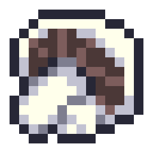{ .syncs-art width="32" } | Champignon | 15 |
| 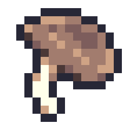{ .syncs-art width="32" } | Shiitake | 30 |
| 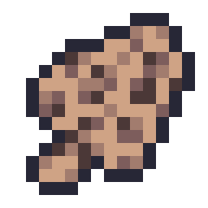{ .syncs-art width="32" } | Morille | 40 |
| 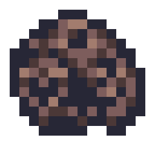{ .syncs-art width="32" } | Truffe | 80 |
| | Savon | 20 |
| | Médicament | 30 |
| | **Sachet** de 3 objets de collection au hasard | 150 (×1 ou ×5) |

La nourriture et les soins vont dans ton **garde-manger** : quand tu nourris ou soignes un Plynling, je pioche d'abord dedans, et je ne prends des cailloux que s'il manque quelque chose. Un sachet s'ouvre tout de suite, et s'il complète une collection, sa récompense tombe aussitôt.

### `/inventory give`

Offre un objet à quelqu'un, tout de suite et sans contrepartie.

- **`user`** : à qui ;
- **`item`** : quel objet (la liste te propose les tiens) ;
- **`quantity`** : combien, de 1 à 99 (1 par défaut).

Ton premier cadeau te vaut le succès **🤝 Générosité**.

### `/inventory trade`

Propose un échange, que l'autre accepte ou refuse.

- **`user`** : avec qui ;
- **`give`** : ce que tu donnes, et **`give_quantity`** combien (1 à 99) ;
- **`want`** : ce que tu veux en échange, et **`want_quantity`** combien (1 à 99).

La proposition est publique et mentionne la personne, avec ce que chacun possède déjà des deux objets. Elle clique **🤝 Accepter** ou **Refuser**. L'offre dure **1 heure**, et tu n'as qu'**une** offre ouverte à la fois : en proposer une nouvelle remplace l'ancienne. Si je redémarre entre-temps, l'offre est perdue.

### `/inventory sell`

Revends des objets contre des cailloux, au prix de leur rareté (voir le tableau plus haut). La nourriture et les soins se revendent comme des objets communs.

- **`item`** : quel objet ;
- **`quantity`** : combien, de 1 à 99 (1 par défaut).

Les cosmétiques ne se revendent pas. Revendre un objet ne défait jamais une collection déjà complétée.

## Le carnet de collection

### `/inventory collection`

Ton carnet de collection, visible par tout le salon.

- **`user`** (optionnel) : le carnet de quelqu'un d'autre. Par défaut, le tien.

La première page résume toutes les collections ; le menu ouvre chacune d'elles, avec trois filtres : **Tout**, **Trouvés**, **Manquants**. Chaque page dit aussi où trouver ce qui manque.

Une collection est **complétée** dès que tu as trouvé chacun de ses objets au moins une fois : pas besoin de les avoir tous en même temps. Un objet échangé ou revendu reste « trouvé » (il s'affiche « ×0 »).

| | Collection | Objets | Récompense |
|:-:|---|---|---|
| 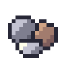{ .syncs-art width="32" } | Cailloux | 8 | 100 |
| 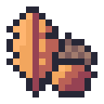{ .syncs-art width="32" } | Nature | 8 | 150 |
| 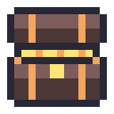{ .syncs-art width="32" } | Trésors | 8 | 200 |
| { .syncs-art width="32" } | Insectes | 8 | 250 |
| { .syncs-art width="32" } | Saisons | 8 | 300 |
| 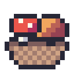{ .syncs-art width="32" } | Champignons | 30 | 1 000 |

Les champignons se trouvent surtout en fouillant avec ton Plynling, et certains objets n'apparaissent qu'à une saison.

### Déposer une collection

Une fois une collection complétée, tu peux la **déposer** : le bouton **Déposer** de sa page (visible seulement quand tu as un exemplaire de chaque objet) prend **un exemplaire de chaque**, après confirmation, et te **paie à nouveau sa récompense**.

Chaque complétion fait monter la collection d'un rang, avec son badge sur ta carte `/level` :

| | Rang | Complétions |
|:-:|---|---|
| 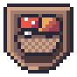{ .syncs-art width="44" } | Bronze | 1 (la première fois) |
| 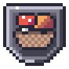{ .syncs-art width="44" } | Argent | 2 |
| 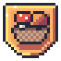{ .syncs-art width="44" } | Or | 3 |
| 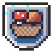{ .syncs-art width="44" } | Platine | 5 |
| 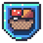{ .syncs-art width="44" } | Diamant | 10 |

Je l'annonce dans le salon quand tu passes un rang. Tes complétions comptent dans la vue **Collections** de [`/leaderboard`](niveaux.md#leaderboard).

## Les cosmétiques

### `/inventory cosmetics`

Un écran **visible par toi uniquement**, en trois onglets :

- **Garde-robe** : ce que tu possèdes. Choisir un cosmétique le met tout de suite à ton Plynling (s'habiller est gratuit).
- **Boutique** : ce qui est en vente. Une partie change **chaque lundi** (la même pour tout le monde), et certains articles ne sont là qu'à une saison.
- **Fabrication** : des cosmétiques qu'on ne peut pas acheter, à fabriquer avec des objets trouvés et quelques cailloux. Les **Ouvrages** sont à portée de quelques fouilles ; les **Chefs-d'œuvre** demandent une vraie chasse. Chaque recette ne se fabrique qu'**une fois** par personne.

Il y a cinq sortes de cosmétiques : **Thème**, **Titre**, **Accessoire**, **Aura** et **Cadre** (celui-ci se voit sur sa tombe). Dans la boutique et la fabrication, choisir un article te le fait **essayer** sur ton Plynling avant de payer ; ensuite **Acheter** (ou **Fabriquer**), ou **Acheter et porter** d'un coup. Ton Plynling peut porter jusqu'à **trois accessoires** à la fois, s'ils ne vont pas au même endroit : un nouveau chapeau remplace l'ancien, et il n'a que deux mains pour tenir des choses. Certains accessoires ont une couleur ou une place à choisir, gratuitement, dans la garde-robe.

<figure markdown="span">
  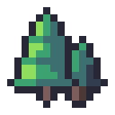{ .syncs-art width="64" }
  <figcaption>Thème</figcaption>
</figure>
<figure markdown="span">
  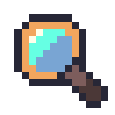{ .syncs-art width="64" }
  <figcaption>Titre</figcaption>
</figure>
<figure markdown="span">
  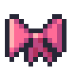{ .syncs-art width="64" }
  <figcaption>Accessoire</figcaption>
</figure>
<figure markdown="span">
  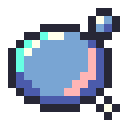{ .syncs-art width="64" }
  <figcaption>Aura</figcaption>
</figure>
<figure markdown="span">
  { .syncs-art width="64" }
  <figcaption>Cadre</figcaption>
</figure>

`/plynling wardrobe` ouvre le même écran directement sur la garde-robe.

### Raretés des cosmétiques

Les cosmétiques ont six raretés. En boutique, cette semaine comme de saison, la rareté fixe le prix :

| Rareté | Prix |
|---|---|
| Commun | 600 cailloux |
| Peu commun | 1 200 cailloux |
| Rare | 2 400 cailloux |
| Épique | 3 600 cailloux |
| Légendaire | 5 000 cailloux |
| Mythique | jamais en vente : ce sont les **Chefs-d'œuvre**, à fabriquer |

Deux articles de chaque sorte (sauf les auras) sont **toujours en vente**, à 300 ou 500 cailloux. Les **Ouvrages** sont peu communs.

Beaucoup de cosmétiques font partie d'une **collection** qui va ensemble (Grand-Froid, Cour royale, Jour de fête…). Ta progression s'affiche en bas de la page garde-robe de `/inventory view`, par exemple « Grand-Froid 3/8 ». C'est pour le plaisir de compléter : rien ne se débloque.

!!! syncs smug ""
    Mythique, ça ne s'achète pas. Même chez moi. Surtout chez moi.

!!! note
    Les cosmétiques se donnent et s'échangent comme les autres objets, mais ne se revendent pas. Si tu donnes ton dernier exemplaire d'un cosmétique porté, ton Plynling l'enlève.
