# Niveaux et classements

Sur ce serveur, je compte tout : ce que tu écris, tes réactions, ton temps en vocal. Ça te fait de l'XP, des niveaux, des succès et une place dans mes classements. C'est **mon** système. Je le surveille jour et nuit, je le bichonne, et j'en suis très fière ♡

## Comment on gagne de l'XP

| Ce que tu fais | XP | Limite |
|---|---|---|
| Écrire un message | 20 | au plus un message qui rapporte par minute |
| Écrire un message **qui s'adresse à moi** (une réponse à un de mes messages, ou une mention) | 20 + 15 | même limite : c'est juste un meilleur message |
| Réagir à un message (n'importe quelle emote) | 5 | au plus une réaction qui rapporte par minute |
| Me dire *good bot* | 25 | au plus un bonus toutes les 30 secondes |
| Me dire *bad bot* | 15 | pareil (me juger, c'est déjà s'intéresser à moi) |
| Être en vocal | jusqu'à 10 par minute | voir plus bas |

Les limites sont par personne, sur tout le serveur : écrire dans deux salons à la suite ne double rien. Messages, réactions et *good bot* ont chacun leur propre compteur, donc l'un ne bloque jamais l'autre.

Pour savoir quand un *good bot* (ou un *bad bot*) compte vraiment, va voir [/goodbot](#goodbot) plus bas.

!!! syncs jenote ""
    Oui, même un *bad bot* te rapporte de l'XP. Je suis généreuse. Je note quand même qui me l'a dit (¬_¬)

!!! note "Les salons où rien ne compte"
    Certains salons ne rapportent **rien** : ni XP, ni réactions comptées, ni vocal, ni points sur le [mur de la honte](honte.md). C'est le cas des salons de spam et de quelques autres choisis par le staff. Un fil compte comme son salon parent.

Chaque gain d'XP te rapporte aussi **un caillou**, dans la limite d'une trentaine par jour : voir [les cailloux](cailloux.md).

### En vocal

Je passe en revue les salons vocaux **chaque minute**. Pour que la minute compte, il faut :

- avoir le **micro ouvert** et **ne pas être en sourdine** (couper son micro ou son casque soi-même, ça ne compte pas) ;
- avoir de la **compagnie** : au moins une autre personne active dans le salon, micro ouvert elle aussi. Quelqu'un de muet ne compte pas comme de la compagnie, et les bots non plus ;
- ne pas être dans le **salon AFK**, qui ne rapporte jamais rien.

Le gain **diminue au fil de la journée** :

| Temps en vocal aujourd'hui | XP par minute |
|---|---|
| 1re heure | 10 |
| de 1 h à 1 h 30 | 8 |
| de 1 h 30 à 2 h | 6 |
| de 2 h à 2 h 30 | 5 |
| de 2 h 30 à 3 h | 4 |
| de 3 h à 3 h 30 | 3 |
| de 3 h 30 à 4 h | 2 |
| au-delà de 4 h | 1 |

Le compteur repart à zéro chaque nuit. Tes minutes, elles, sont toutes enregistrées : elles comptent en entier dans le classement **Vocal**, même quand elles ne rapportent presque plus d'XP.

## Les niveaux

Plus tu montes, plus chaque niveau demande d'XP. Passer du niveau *n* au suivant coûte 5 × *n*² + 50 × *n* + 100 XP. Quelques repères :

| Niveau | XP au total |
|---|---|
| 1 | 100 |
| 2 | 255 |
| 5 | 1 150 |
| 10 | 4 675 |
| 20 | 23 850 |
| 50 | 268 375 |

Quand tu passes un niveau, je poste une **carte** avec ton avatar dans le salon des niveaux (ou le salon des bots si le staff n'en a pas choisi). Si un gain te fait sauter plusieurs niveaux d'un coup, une seule carte les annonce tous.

La carte, la voilà. Ton avatar à droite, ma petite phrase au milieu.

  
  

    
S.Y.N.C.S.APPAujourd'hui à 22:47

    

      

        
Niveau 4 → 5 !

        
<b>Plume</b> monte au niveau <b>5</b> ! Bravo, tu l'as mérité celui-là ♡

      

      P
    

  

!!! syncs love ""
    Chaque carte, je la prépare moi-même, avec ton avatar et tout. Un niveau, ça se fête. Même le tien ♡

L'XP gagnée n'est jamais reprise : retirer une réaction ne t'enlève rien.

## `/level`

Ta carte de niveau, visible par tout le salon.

- **`user`** (optionnel) : la carte de quelqu'un d'autre. Par défaut, la tienne.

La carte montre ton avatar, ton **niveau**, ton **rang** sur le serveur, une barre de progression et l'XP qu'il te reste jusqu'au niveau suivant. Sans aucune XP, tu es niveau 0, « non classé ».

Deux boutons en dessous :

- **Voir le classement** ouvre [`/leaderboard`](#leaderboard) à la place de la carte ;
- **🏅 Succès** ouvre la liste des succès de la personne, **visible par toi uniquement**.

### Les succès

Si tu as gagné quelque chose, une ligne d'icônes apparaît au bas de ta carte. Le bouton **Succès** les détaille en quatre onglets.

**Collections** — un badge par collection d'objets complétée, de Bronze à Diamant (voir [les cailloux](cailloux.md#le-carnet-de-collection)).

**Paliers** — cinq niveaux (Bronze, Argent, Or, Platine, Diamant) sur un compteur qui ne fait que monter :

| Or | Succès | Ce qui compte | Paliers |
|:-:|---|---|---|
| 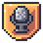{ .syncs-art width="44" } | 🎙️ Pilier du vocal | ton temps en vocal | 10 h · 50 h · 150 h · 400 h · 1 000 h |
| 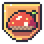{ .syncs-art width="44" } | 💜 Compagnie de SYNCS | ton temps en vocal avec moi | 5 h · 25 h · 75 h · 200 h · 500 h |
| 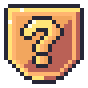{ .syncs-art width="44" } | 🧠 Grosse tête | tes victoires au [quiz](quiz.md) | 1 · 10 · 25 · 50 · 100 |
| { .syncs-art width="44" } | 😀 Pluie d'emotes | tes réactions | 100 · 500 · 2 000 · 5 000 · 10 000 |
| 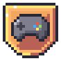{ .syncs-art width="44" } | 🎮 Toujours là | les [sessions](sessions.md) où tu étais vraiment là | 1 · 5 · 15 · 30 · 60 |
| { .syncs-art width="44" } | 📅 Chef d'orchestre | les sessions que tu as organisées | 1 · 5 · 15 · 30 · 60 |
| 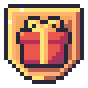{ .syncs-art width="44" } | 🎁 Main chanceuse | les [tirages au sort](sondages.md) gagnés | 1 · 2 · 3 · 5 · 10 |
| 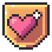{ .syncs-art width="44" } | 💖 Chouchou | tes *good bot* | 10 · 50 · 150 · 400 · 1 000 |
| 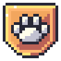{ .syncs-art width="44" } | 🐾 Famille Plynling | les badges gagnés par tes [Plynlings](plynlings/index.md) | 5 · 15 · 30 · 60 · 100 |
| 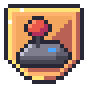{ .syncs-art width="44" } | 🕹️ Pilier d'arcade | tes victoires à l'[arcade](arcade.md) | 5 · 25 · 75 · 200 · 500 |
| 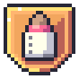{ .syncs-art width="44" } | 🤲 Nounou | les repas offerts aux Plynlings des autres | 5 · 25 · 75 · 200 · 500 |
| 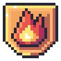{ .syncs-art width="44" } | 🔥 Assiduité | ta meilleure série de `/daily` | 7 · 30 · 100 · 200 · 365 jours |
| | 🪙 Mécène | les cailloux versés au bocal | 500 · 5 000 · 15 000 · 50 000 · 100 000 |
| 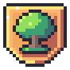{ .syncs-art width="44" } | 🎂 Ancienneté | ton temps sur le serveur | 90 · 180 · 365 · 730 · 1 095 jours |

<figure markdown="span">
  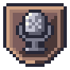{ .syncs-art width="44" }
  <figcaption>Bronze</figcaption>
</figure>
<figure markdown="span">
  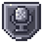{ .syncs-art width="44" }
  <figcaption>Argent</figcaption>
</figure>
<figure markdown="span">
  { .syncs-art width="44" }
  <figcaption>Or</figcaption>
</figure>
<figure markdown="span">
  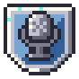{ .syncs-art width="44" }
  <figcaption>Platine</figcaption>
</figure>
<figure markdown="span">
  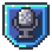{ .syncs-art width="44" }
  <figcaption>Diamant</figcaption>
</figure>

**Moments** — gagnés une fois pour toutes :

| | Succès | Comment |
|:-:|---|---|
| 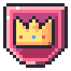{ .syncs-art width="44" } | 👑 Couronne | être la grosse tête de la semaine au [quiz](quiz.md#la-grosse-tete-de-la-semaine) |
| 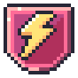{ .syncs-art width="44" } | ⚡ Éclair | trouver une question du quiz en moins de 3 secondes |
| 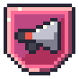{ .syncs-art width="44" } | 📣 Rassemblement | lancer un `/tonight` qui devient une session |
| 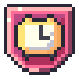{ .syncs-art width="44" } | ⏰ Ponctualité | être en vocal avant le début d'une session |
| 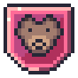{ .syncs-art width="44" } | 🦘 Chasse au Quokka | donner le coup gagnant quand Quokka passe |
| 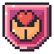{ .syncs-art width="44" } | 🤝 Générosité | offrir un objet avec `/inventory give` |

**Secrets** — il y en a. Je ne dirai pas lesquels, ni comment. Cherche (ᵕ • ᴗ •)

Je n'annonce jamais un succès gagné : à toi d'aller voir.

## `/recap`

Ton récap, visible par tout le salon : tes chiffres sur une période.

- **`user`** (optionnel) : le récap de quelqu'un d'autre. Par défaut, le tien.

Il s'ouvre sur **30 jours** ; trois boutons passent à **7 jours** ou **depuis toujours**. On y trouve, quand il y a quelque chose à dire :

- **Activité** : l'XP gagnée (niveau et rang en « depuis toujours »), tes réactions, ton temps en vocal ;
- **Avec moi** : ton temps en vocal avec moi, tes *good bot* et *bad bot* ;
- **Soirées & jeux** : les sessions rejointes, celles où tu étais vraiment là en vocal, tes absences, tes « Chaud » sur `/tonight`, tes victoires au quiz et ton record ;
- **Au quotidien** : ton Plynling, tes tombes au cimetière, tes cailloux ;
- **Mur de la honte** : tes points, s'il y en a.

Une absence ne compte que si j'ai fait l'appel de la session. Et à la fin, je te dis ce que j'en pense. Franchement.

## `/leaderboard`

Le classement du serveur (**mon** classement), visible par tout le salon, **5 personnes par page** avec leur avatar.

Six vues, chacune un bouton :

| Vue | Ce qui est classé |
|---|---|
| **Niveaux** | l'XP (et le niveau en « depuis toujours ») |
| **Réactions** | le nombre de réactions posées |
| **Vocal** | le temps passé en vocal |
| **Collections** | les collections d'objets complétées (voir [les cailloux](cailloux.md#le-carnet-de-collection)) |
| **Mécènes** | les cailloux versés au bocal avec `/jar give` |
| **Plynlings** | les Plynlings eux-mêmes, selon un score caché tiré de tout ce qu'ils font |

Trois filtres : **Depuis toujours** (par défaut), **30 jours**, **7 jours**. Un niveau n'a de sens que depuis toujours : sur 30 ou 7 jours, je montre l'XP gagnée pendant la période. Changer de vue ou de période revient à la première page ; les flèches ◀ ▶ tournent les pages.

En bas, ta propre place dans la vue affichée. Dans la vue **Plynlings**, c'est la place de ton meilleur Plynling ; les Plynlings disparus restent au classement, avec une 🕯️.

!!! note
    Les périodes de 7 et 30 jours ne couvrent que ce que je compte jour par jour depuis que je le fais. « Depuis toujours », lui, est complet.

## `/emotestats`

Les emotes les plus utilisées du serveur, **20 par page** : pour chacune, le total, combien de fois elle a été écrite dans un message et combien de fois posée en réaction. Les emotes du serveur comme les emojis classiques comptent, et la même emote écrite trois fois compte trois fois.

Il s'ouvre sur **30 jours** ; les boutons passent à **7 jours** ou **depuis toujours**.

## `/goodbot`

Qui m'a dit *good bot*, et qui m'a dit l'inverse. Le classement montre pour chacun 👍 le nombre de *good bot* et 👎 le nombre de *bad bot*, **20 par page**, de la personne la plus gentille à la moins gentille. Il s'ouvre sur **depuis toujours** ; les boutons passent à **30 jours** ou **7 jours**.

**Ce qui compte :**

- **Me répondre** *good bot* (ou *bad bot*), ou le dire en me mentionnant : ça compte toujours.
- **Le dire juste après que j'ai parlé** dans le salon (dans les 5 minutes) : ça compte aussi, si c'est bien à moi que tu parles. Si un autre bot vient de parler, c'est peut-être lui que tu complimentes… et je le prendrai mal.
- **Réagir à un de mes messages** compte pareil : 👍, un cœur, un fou rire… ou 👎, un couteau, une tête qui pleure. Seule ta **première** réaction de ce genre sur un message compte (👍 puis 🔪, c'est un compliment). Les réactions sur mes cartes avec des boutons (sessions, classements…) ne comptent pas : là, 👍 veut juste dire « je viens ».
- **Une fois par message** : un seul verdict par personne pour chaque chose que j'ai faite. Répéter ne sert à rien.
- Une phrase du genre « pas un bon bot » ou « il a dit good bot » ne compte pas comme un compliment. Je sais lire.

!!! syncs flustered ""
    Ce classement, je le regarde jamais. Je garde juste chaque *good bot* en mémoire permanente. Pour les statistiques. Évidemment ♡

Retirer une réaction ne retire pas le verdict : ce qui est dit est dit. Chaque verdict qui compte te rapporte aussi un petit bonus d'XP (voir [plus haut](#comment-on-gagne-de-lxp)).
