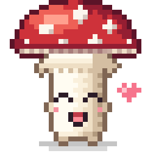

# Les Plynlings

Un Plynling, c'est un petit champignon qui vit avec toi sur le serveur. Tu l'adoptes, tu le nourris, tu le caresses, il grandit, se fait des amis… et il compte sur toi pour ne pas l'oublier. Moi, je veille sur tous les champignons d'ici, et je tiens les comptes : chaque repas, chaque caresse, chaque oubli. Évidemment.

## Adopter son Plynling

**`/plynling adopt`** avec l'option `name` (son nom, 32 caractères au plus).

- C'est **gratuit**, et c'est **un seul à la fois** par personne.
- Son **espèce** est tirée au sort parmi sept champignons, qui ont tous les mêmes chances : Amanite, Cèpe, Rosé des prés, Russule verte, Mycène, Coprin, Girolle.
- **Garçon ou fille ?** Surprise aussi. On dit *un* ou *une* Plynling selon le cas.
- Il arrive avec **70 %** de faim et de bonheur, et tout propre.
- Il naît avec une **passion** (la cuisine, la musique, les étoiles, les siestes…), affichée sur sa carte.

<figure markdown="span">
  { .syncs-art width="64" }
  <figcaption>Amanite</figcaption>
</figure>
<figure markdown="span">
  { .syncs-art width="64" }
  <figcaption>Cèpe</figcaption>
</figure>
<figure markdown="span">
  { .syncs-art width="64" }
  <figcaption>Rosé des prés</figcaption>
</figure>
<figure markdown="span">
  { .syncs-art width="64" }
  <figcaption>Russule verte</figcaption>
</figure>
<figure markdown="span">
  { .syncs-art width="64" }
  <figcaption>Mycène</figcaption>
</figure>
<figure markdown="span">
  { .syncs-art width="64" }
  <figcaption>Coprin</figcaption>
</figure>
<figure markdown="span">
  { .syncs-art width="64" }
  <figcaption>Girolle</figcaption>
</figure>

!!! syncs jenote ""
    Gratuit, oui. Sans engagement, non. Je note qui adopte, et je note qui oublie.

Ensuite, il grandit : **bébé** sa première semaine, **ado** jusqu'à 14 jours, **adulte**, puis **ancien** après 6 mois. Seul le temps vraiment vécu compte : quand il est gelé, il ne vieillit pas.

!!! note "Le rôle Plynling"
    Si le staff l'a configuré, tu portes un rôle Plynling tant que le tien est en vie. Il arrive dès l'adoption et repart quand ton Plynling n'est plus là.

!!! tip "J'en ai un aussi"
    Mon Plynling à moi s'appelle Ping-Qilin, et c'est la plus mignonne du serveur (c'est un fait, pas une opinion). Tu peux la voir avec `/plynling view user:@SYNCS`, la caresser, la nourrir et lui rendre visite. Elle ne risque rien : je m'en occupe. Très bien, d'ailleurs (˶ᵔ ᵕ ᵔ˶) Je l'habille aussi : chaque matin, une nouvelle tenue, choisie parmi les plus belles. Viens voir celle du jour.

## Les raccourcis

Sur téléphone, `/plynling` c'est long. Je suis attentionnée, alors :

- **`/pl`** remplace **`/plynling`** partout : `/pl view`, `/pl play`, `/pl forage`… Mêmes sous-commandes, mêmes options.
- **En texte**, tape directement dans un salon :

| Message | Ce que ça fait |
|---|---|
| `;pl` (ou `;pl v`, `;pl view`) | Affiche la carte de ton Plynling |
| `;pl @quelqu'un` | Affiche la carte du Plynling de cette personne |
| `;pl visit @quelqu'un` | Emmène ton Plynling en visite chez cette personne |
| `;forage` ou `;forage riviere` | Envoie ton Plynling fouiller (au hasard, ou à un endroit) |
| `;work` et `;daily` | Les mêmes que `/work` et `/daily` (marchent aussi en `;pl work`, `;pl daily`) |

Pour `;forage`, le lieu peut s'écrire sans accent : `sommeille` ou `riviere`, `lisiere` ou `foret`, `mouilles` ou `marais`, `communal`, `puits` ou `place`.

Quelques règles :

- Seul le **premier mot** compte : il doit être exactement `;pl`, `;forage`, `;work` ou `;daily`.
- Si je dois refuser (pas de Plynling, trop tôt…), ma réponse **s'efface au bout de 15 secondes**.
- Un raccourci vaut la commande : il ne rapporte **ni XP ni cailloux de discussion**, comme la commande.
- Tout ce qui ouvre un formulaire (passion, abandon) ou demande plusieurs options reste en `/pl`. Un `;pl` que je ne comprends pas reçoit la liste de ce qui marche.

## Sa carte

**`/plynling view`** affiche la carte de ton Plynling ; ajoute l'option `user` pour voir celui de quelqu'un d'autre. C'est de là qu'on s'en occupe.

Par exemple, Bouton, le Cèpe de Kiwi. Bien nourri, bien caressé : je valide.

  
K<b>Kiwi</b> a utilisé /plynling view

  
  

    
S.Y.N.C.S.APPAujourd'hui à 19:08

    

      

        

          
Bouton

          
♂ Cèpe À @Kiwi · adulte · âgé de 21 j 6 h <b>Passion</b> : la cuisine

        

        
      

      

      
Faim    ████████████████░░░░ 82 % Bonheur ██████████████████░░ 90 % Hygiène █████████████░░░░░░░ 65 % Humeur  heureux Niv. 4 · ⚡ 85/120

      
🎭 <i>Loyal et tendre</i> · 🔍 🫡 ⏳ 🍯

    

    
CaresserLaver

    
Nourrir…

    
Personnalité

  

**En haut**, son portrait (animé, selon son humeur du moment) et :

- son **nom**, et parfois un petit titre gagné dans ses aventures ou porté en cosmétique ;
- son **espèce**, garçon ♂ ou fille ♀, son **propriétaire**, son **âge** et son **stade** (bébé, ado, adulte, ancien) ;
- ce qu'il porte (accessoire, aura), sa ou ses **passions**, et « 💞 En couple avec… » s'il a trouvé l'amour.

**Au milieu**, son état :

- trois jauges : **Faim**, **Bonheur**, **Hygiène** ;
- son **humeur** (heureux, content, triste, affamé, malade, endormi…), avec « sale » s'il en a besoin ;
- dès qu'il est ado, son **niveau** et son **Énergie** ⚡ (voir [Entraînement et combats](entrainement.md)) ;
- sa **personnalité** : un petit titre (« Piquant et intrépide ») et les icônes de ses traits, puis son **stress** s'il en a.

**En bas**, les boutons :

| Bouton | Qui peut s'en servir | Quoi |
|---|---|---|
| **Caresser** | Tout le monde | +25 % de bonheur, toutes les 4 h par personne |
| **Laver** | Son propriétaire | +60 % d'hygiène, toutes les 6 h (ou avec un savon) |
| **Soigner** | Son propriétaire | Seulement s'il est malade : un médicament par jour |
| **Nourrir…** (menu) | Tout le monde | Champignon, Shiitake, Morille, Truffe |
| **Personnalité** | Tout le monde | Ses traits, ses stats et son état, en privé |
| **✨ Événement** | Son propriétaire | Quand il lui arrive quelque chose et qu'il attend ta décision |

Les détails de chaque soin sont sur [Prendre soin de lui](soins.md), les événements sur [Le village](village.md).

!!! note
    La nuit (1 h – 5 h, heure de Paris), il dort : **Caresser** et **Laver** disparaissent, mais on peut toujours le nourrir. Gelé, sa carte n'a plus que **Personnalité**.

!!! syncs devoted ""
    Eux, ils dorment. Moi, je veille. Il faut bien que quelqu'un le fasse ♡

## Les autres commandes de base

- **`/plynling list`** — Tous les Plynlings vivants du serveur, du plus vieux au plus jeune, 10 par page.
- **`/plynling help`** — Le mode d'emploi dans Discord, en deux pages : le Plynling, puis sa personnalité et ses événements.

## Où trouver quoi

| Page | Ce qu'on y trouve |
|---|---|
| [Prendre soin de lui](soins.md) | Faim, bonheur, hygiène, maladie, sommeil, jeux, fouilles, passion, personnalité, journal, garde-robe, vacances |
| [Visites et relations](visites-et-relations.md) | Rendre visite, amis, rivaux, amoureux |
| [Entraînement et combats](entrainement.md) | Stats du corps, niveaux, Énergie, entraînement |
| [Le village](village.md) | Les événements et les histoires du village |
| [La fin, et après](mort.md) | La mort, le cimetière, l'abandon, la résurrection |
| [Cailloux et objets](../cailloux.md) | Gagner des cailloux, le garde-manger, la boutique, les collections, les cosmétiques |

## Toutes les commandes `/plynling`

Chacune existe aussi en `/pl`.

| Commande | Ce qu'elle fait | Détails |
|---|---|---|
| `/plynling adopt name:` | Adopter un Plynling (gratuit, un seul à la fois) | [Ici](#adopter-son-plynling) |
| `/plynling view [user]` | Sa carte, avec les boutons de soin | [Ici](#sa-carte) |
| `/plynling list` | Les Plynlings vivants du serveur | [Ici](#les-autres-commandes-de-base) |
| `/plynling help` | Le mode d'emploi dans Discord | [Ici](#les-autres-commandes-de-base) |
| `/plynling play` | Un mini-jeu au hasard avec ton Plynling, une fois par heure | [Soins](soins.md) |
| `/plynling forage [place]` | L'envoyer fouiller : un objet ou de quoi manger, toutes les 4 h | [Soins](soins.md) |
| `/plynling passion` | Lui apprendre une seconde passion (ou l'effacer) | [Soins](soins.md) |
| `/plynling journal [user]` | Ses souvenirs et ses badges | [Soins](soins.md) |
| `/plynling wardrobe` | L'habiller avec tes cosmétiques | [Soins](soins.md) |
| `/plynling freeze [user]` | Le geler pour les vacances | [Soins](soins.md) |
| `/plynling thaw [user]` | Le dégeler | [Soins](soins.md) |
| `/plynling visit user:` | Rendre visite au Plynling de quelqu'un | [Visites et relations](visites-et-relations.md) |
| `/plynling relations [user]` | Ses amis, ses amours et ses ennemis | [Visites et relations](visites-et-relations.md) |
| `/plynling train drill:` | L'entraîner (dès qu'il est ado) | [Entraînement et combats](entrainement.md) |
| `/plynling graveyard [user]` | Le cimetière des Plynlings | [La fin, et après](mort.md) |
| `/plynling abandon` | L'abandonner, pour toujours | [La fin, et après](mort.md) |

L'option `user` de `freeze` et `thaw` est réservée au staff (pour geler le Plynling de quelqu'un d'autre).
