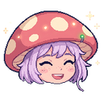

# Le village

Les Plynlings vivent à **Humeval**, un petit village tranquille. C'est là que se passent leurs visites et leurs événements : petites histoires du quotidien, où c'est toi qui choisis ce que fait ton Plynling. Moi, je n'y mets jamais les pieds. Pas de pieds. Mais je regarde. Beaucoup.

## Humeval en deux mots

Humeval, c'est un hameau d'une quinzaine de maisons au creux d'une vallée humide, entre une rivière lente, **la Sommeille**, et la lisière d'une très vieille forêt. Une époque de conte : moulin à eau, four à pain, lanternes, lettres portées à pied.

- **Les villageois** sont des gens-plantes et des gens-champignons : un frêne, une sauge, une ortie, un chardon…
- **Les animaux sont des animaux** : poules, chèvres, abeilles, grenouilles, et quelques sangliers qui retournent les potagers.
- **Les Plynlings sont les pousses du village.** Ils sortent de **la Souche**, le reste d'un arbre immense à la lisière de la forêt, et grandissent vite, comme tout champignon. Personne ne sait vraiment pourquoi la Souche fait ça, et personne n'est pressé de le savoir.
- **La monnaie**, ce sont les cailloux : des galets de la Sommeille.

**Le ton est tout doux.** À Humeval, une catastrophe, c'est une dispute, une pomme volée ou un gâteau raté. Un choix « mal tourné » donne une scène drôle ou un peu penaude, et le village, lui, ne change pas : chacun reste à sa place, avec son métier et ses manies.

!!! syncs grumpy ""
    Là-bas, une catastrophe, c'est un gâteau raté. Ici, c'est un sondage où tout le monde vote « peut-être ». Je préfère Humeval.

## Quelques lieux

| Lieu | Ce qu'on y trouve |
|---|---|
| **La place du Puits** | Le cœur du hameau : le marché, les annonces, les enfants qui courent. |
| **L'auberge du Pont-Vieux** | Le salon du village : ragots, voyageurs, parties de cartes. |
| **Le four du village** | Chacun y cuit son pain à son jour. Ça sent bon jusqu'à la place. |
| **Le moulin de la Sommeille** | Là où tout le grain est moulu. |
| **La Maison des Pousses** | La longue maison où les Plynlings ados vivent ensemble. |
| **La Lisière** | La bordure de la forêt, avec la Souche. |
| **Les Mouilles** | Le marais : roseaux, libellules, et de la boue jusqu'aux genoux. |
| **Le Communal** | Pâture et bois communs, source éternelle de petites disputes. |

Certains de ces lieux sont aussi des endroits où envoyer ton Plynling fouiller avec `/plynling forage` (voir [Cailloux et objets](../cailloux.md)).

## Quelques visages

Au fil des histoires, ton Plynling croisera des villageois. On les appelle tous par leur surnom :

| Qui | Ce qu'il ou elle fait |
|---|---|
| **La Mère Lichen** | Très vieille, elle accueille les pousses à leur sortie de la Souche. |
| **La Bruyère** | Tient la Maison des Pousses, et ses règles. |
| **Maître Frêne** | Le syndic du conseil, incapable de trancher quoi que ce soit. |
| **L'Intendant** | Descend du bourg voisin pour tout compter. Le village adore lui compliquer la tâche. |
| **La Courge** | L'aubergiste. |
| **Pain-Blond** | Le boulanger. |
| **La Sauge** | L'herboriste, au bout du chemin. |
| **Le Tilleul** | Le gardien du verger et des ruches, et des vieilles histoires. |

Il y en a d'autres. Je te laisse les rencontrer.

!!! syncs jenote ""
    Quelqu'un qui compte tout, et tout le monde qui lui complique la tâche ? Je compatis, l'Intendant. Énormément.

## Les événements { #evenements }

À peu près **une fois par jour**, en journée, il arrive quelque chose à ton Plynling. D'autres moments en amènent aussi : son arrivée, grandir, tomber malade et guérir, parfois une visite, ou un trop-plein de stress.

- Un bouton **« ✨ Événement (n) »** apparaît sur sa carte (`/plynling view`). **3 événements du jour au plus** peuvent attendre en même temps.
- **Seul son propriétaire** peut l'ouvrir. Le choix se fait **en privé**.
- Certaines histoires sont courtes (un seul choix, ou deux ou trois) ; d'autres **durent plusieurs jours**, une étape par jour. Tant qu'une longue histoire est en cours, pas d'autre événement du jour.
- Certaines n'arrivent qu'**à leur saison**, au vrai calendrier : la foire au printemps, la moisson l'été, le jour du Compte à l'automne, la Longue Nuit l'hiver.

### Choisir pour lui

Quand tu ouvres l'événement, je te montre la scène et 2 à 4 choix. Sous chaque choix, une ligne dit **ce qu'il demande, ce qu'il coûte et ce qu'il peut rapporter** :

| Signe | Ce que ça veut dire |
|---|---|
| Icône d'un trait, ou d'une stat avec « 4+ » | Il faut ce trait ou ce niveau de stat. |
| 🎲 Courage 55 % | Un **défi** : ses vraies chances de réussir, puis ce qui se passe si ça marche, et « sinon ». |
| 😣 +20 stress | Ce choix va contre son caractère : il le stressera. |
| 😌 −30 stress | Ce choix l'apaise. |
| 🪙 · 🎁 | Des cailloux, un objet. |
| Icône et nom d'une stat ou d'une humeur | Une leçon, ou une humeur pour quelques jours (voir plus bas). |
| ❤️ le Tilleul s'en souviendra | Un villageois s'en souviendra, en bien. Sans le ❤️, pas forcément en bien. |
| 🏷️ un titre · 🎁 un souvenir à garder · ✨ un trait change | Ce que peut laisser la fin d'une longue histoire. |
| 🔒 | Un choix fermé pour l'instant, avec ce qui manque pour l'ouvrir. |
| ❔ on verra bien | Une surprise. Les coûts et les chances restent affichés. |

!!! syncs smug ""
    Les chances affichées sont les vraies. Moi, je ne mens jamais sur les chiffres. Sur le reste, ça dépend (˶˃ ᵕ ˂˶)

Une fois ton choix fait, l'histoire est **racontée dans le salon du jeu**, page par page (◀ ▶), pour que tout le monde en profite.

!!! tip "Pas le temps ? Il se débrouille"
    Sans réponse de ta part en **24 heures**, il décide **tout seul**, selon son caractère, **sans jamais y perdre quoi que ce soit** : pas de stress, pas de mauvaise humeur (la seule exception, c'est quand il craque, voir [Le stress](#stress)). Jouer apporte plus, ne pas jouer ne coûte rien.

Quelques règles en plus :

- **Gelé, rien ne bouge** : pas de nouvel événement, pas de choix, et le délai de 24 h attend son dégel.
- **S'il meurt**, ce qui l'attendait est annulé.

### Ce que ses choix laissent

- **Une leçon** : une stat monte pour quelques jours, et parfois, rarement, pour de bon.
- **Une humeur** (💡, 🌧️…) pour quelques jours, qui joue sur ses stats, son appétit ou son bonheur.
- **Ce qu'il vit ado** oriente le trait qu'il gagnera adulte.
- **Des souvenirs au village** : un villageois peut se souvenir de ce que ton Plynling a fait, et plus tard, ça peut ouvrir (ou fermer) certains choix.
- À la fin d'une longue histoire, **un titre** (affiché à côté de son nom sur sa carte et annoncé dans le salon du jeu), **un souvenir à garder**, ou un **trait qui change**.

Tout ça se retrouve dans le bouton **Personnalité** de sa carte, rubrique « Histoire ».

### Le stress { #stress }

Le stress ne vient **que de tes choix** : forcer un choix contre son caractère coûte le stress affiché. Il se voit sur sa carte dès qu'il dépasse 0.

- **Caresses, jeux, visites et bains** l'apaisent, et chaque matin aussi (voir [Prendre soin de lui](soins.md)).
- À chaque palier (**100, 200, 300**), ça empire : son bonheur file plus vite, puis ses stats baissent, et il **craque**. C'est un événement à part, qui peut lui laisser une manie pour faire face. Là, même s'il décide seul, il peut en garder une trace : c'est le stress accumulé qui parle.

## Les événements à deux { #a-deux }

Certains événements concernent **un autre Plynling** : une déclaration, un défi, un pacte, une réconciliation…

- Tu fais le premier choix pour le tien, puis **le propriétaire de l'autre reçoit la question sur sa propre carte** (« ✨ Événement »), et choisit à son tour.
- Lui aussi a 24 heures ; sans réponse, son Plynling décide seul.
- Ces événements peuvent rapprocher ou éloigner les deux Plynlings, comme une visite.
- **Une déclaration** suit les mêmes règles que l'aveu en visite : un garçon et une fille, meilleurs amis, personne déjà en couple, pas de refus entre eux depuis 3 jours (voir [Visites et relations](visites-et-relations.md#aveu)).

Bonne vie au village. Raconte-moi tout. Enfin, je le saurai déjà, mais raconte quand même (ᵕ • ᴗ •)
