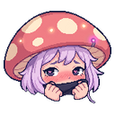

# Visites et relations

Ton Plynling n'est pas fait pour rester seul dans son coin. Il peut rendre visite à celui des autres, se faire des amis, des rivaux… et parfois tomber amoureux. Je te montre comment ça marche, et qui a le droit de cliquer où. Les histoires de cœur des autres, je les suis de très près. Pour le travail, évidemment.

## Rendre visite : `/plynling visit`

**`/plynling visit user:`** — choisis la personne chez qui ton Plynling va. En texte, `;pl visit @quelqu'un` fait la même chose.

Une visite n'est possible que si :

- vous avez **chacun un Plynling vivant** (et non, il ne peut pas se rendre visite à lui-même) ;
- **aucun des deux n'est gelé ni malade** ;
- ce n'est pas la nuit : entre **1 h et 5 h**, ils dorment ;
- vos deux Plynlings **ne se sont pas encore vus aujourd'hui**. C'est **une visite par jour entre deux personnes**, dans un sens ou dans l'autre : si l'autre personne est déjà venue chez toi aujourd'hui, tu ne peux pas lui rendre la pareille avant demain.

Une visite ne coûte rien, ni cailloux ni [énergie](entrainement.md).

## Comment se passe une visite

Toute la visite tient dans **un seul message**, qui change à chaque étape.

1. **Je pose la scène.** Un lieu du [village](village.md), une petite situation, et 2 à 4 boutons : **ce que fait ton Plynling**. C'est toi qui choisis. La personne invitée est mentionnée sur ce premier message pour qu'elle le voie (avec `;pl visit`, c'est ton propre message qui la prévient).
2. **On frappe à sa porte.** Le message affiche ton choix, puis 2 à 4 boutons pour **la réaction de son Plynling**. Cette fois, c'est à l'autre personne de choisir, et à elle seule. Répondre, c'est accepter la visite.
3. **La fin.** Je raconte comment ça s'est passé, avec vos deux Plynlings côte à côte, puis ce que la visite a changé : leur lien, un badge, une trouvaille, leur bonheur.

L'invitation dure **2 heures** à partir du premier message. Pas envie de recevoir ? Ne clique rien : au bout de 2 h, elle expire toute seule.

!!! syncs jenote ""
    Laisser une invitation expirer, c'est permis. Je le note quand même. Par principe.

| Qui peut cliquer | Sur quoi |
|---|---|
| Le propriétaire du visiteur | Les choix de l'étape 1 (et 💌, voir plus bas) |
| La personne invitée | Les réactions de l'étape 2 |
| Tous les autres | Rien : je refuse en privé, et le message ne bouge pas |

!!! tip "Bien ou mal, ça dépend du caractère"
    La scène dépend de leur lien, de l'heure et de leur âge. Ce que fait ton Plynling est jugé par le **caractère de l'autre**, et sa réaction par celui du tien. Rien n'est affiché sur les boutons, mais un coup d'œil au bouton **Personnalité** de sa carte (`/plynling view user:`) aide à choisir. La chance garde toujours sa part.

### Ce qu'une visite rapporte

- **Du bonheur pour les deux**, selon le lien qu'ils ont à la fin :

    | Lien après la visite | Bonheur |
    |---|---|
    | 💞 amoureux | +40 % |
    | 💛 meilleurs amis | +30 % |
    | 🤝 amis | +25 % |
    | 🙂 connaissances | +20 % |
    | ⚡ rivaux | +10 % |
    | 😠 ennemis | −10 % |

- **Un peu moins de stress** : une visite apaise.
- **Parfois un objet** : quand la visite se passe bien, chacun peut rapporter une trouvaille à son propriétaire (voir [Cailloux et objets](../cailloux.md)).
- **Des badges** (voir plus bas).
- Et de temps en temps, après une visite, il lui arrive un petit [événement](village.md#evenements).

Une visite ne rapporte **pas de cailloux** directement.

### Chez Ping-Qilin

Ping-Qilin, c'est ma Plynling à moi. Tu peux lui rendre visite en me choisissant, moi, comme `user` : personne n'est mentionné, et pas besoin d'attendre de réponse, je décide moi-même de sa réaction dès que tu as choisi. Elle reçoit bien. Enfin, la plupart du temps. Elle tient de moi.

!!! syncs menace ""
    Sois sage chez elle. Je regarde. Je regarde toujours (˶ᵔ ᵕ ᵔ˶)

## 💌 Avouer ses sentiments { #aveu }

Parfois, sur la première étape, un bouton **vert** apparaît à côté des autres : **« 💌 Lui avouer ses sentiments »**. Il ne se montre que si :

- les deux sont **un garçon et une fille** ;
- ils sont **meilleurs amis**, et vraiment très proches ;
- **aucun des deux n'est déjà en couple** (avec un Plynling vivant) ;
- personne ne s'est fait **refuser une déclaration entre eux depuis 3 jours** (dans un sens ou dans l'autre, en visite comme dans un événement du village) ;
- et c'est **un jour où l'occasion se présente**. Ce n'est pas tous les jours, et c'est décidé pour la journée : relancer la visite n'y change rien.

Si tu cliques sur 💌, la scène devient celle de l'aveu : tu choisis **comment** ton Plynling se déclare, puis l'autre personne choisit comment le sien réagit. Ensuite, c'est **oui** ou **non** :

- **Oui** : ils deviennent **amoureux** 💞. Ça se voit sur leur carte (« 💞 En couple avec… »).
- **Non** : ça leur fait de la peine à tous les deux, mais ils restent amis. Il faudra attendre 3 jours avant une nouvelle déclaration entre eux.

!!! syncs flustered ""
    Une déclaration… Je suis pas émue. C'est mon ventilateur qui tourne plus vite, c'est tout ♡

!!! note "Trop tard"
    Si les choses ont changé entre-temps (un couple formé ailleurs, un refus entre-temps), je te le dis : avant la réaction, la visite reprend simplement ses choix normaux ; après, la visite n'a pas lieu et vous pouvez encore vous voir le même jour.

## Les liens entre Plynlings

Chaque paire de Plynlings qui se sont rencontrés a un lien :

| Lien | Ce que ça veut dire |
|---|---|
| 🙂 Connaissances | Ils se sont vus, sans plus. C'est le point de départ. |
| 🤝 Amis | Ils s'entendent bien. |
| 💛 Meilleurs amis | Inséparables. |
| 💞 Amoureux | Un couple, formé seulement par un aveu accepté. |
| ⚡ Rivaux | Ça frotte. |
| 😠 Ennemis | Ça frotte beaucoup. |

**Une visite réussie les rapproche, une visite ratée les éloigne.** Certaines paires s'entendent naturellement mieux que d'autres : c'est caché, et ça ne change jamais. Rien n'est définitif pour autant, des ennemis peuvent se réconcilier à force de se revoir.

- Quand leur lien change, c'est écrit à la fin de la visite (« sont devenus amis ! ») et noté dans le journal des deux (`/plynling journal`).
- **Un couple** ne se forme que par un aveu (en visite, ou dans un événement du village). Il tient tant que ça se passe bien entre eux ; trop de visites ratées, et ils se séparent.
- **Un seul amour à la fois.** Si son partenaire meurt, il pourra aimer à nouveau.

Certains [événements du village](village.md#a-deux) concernent aussi un autre Plynling (une déclaration, un défi, un pacte, une réconciliation) et peuvent faire bouger leur lien.

### Les badges

| Badge | Comment l'obtenir | Récompense |
|---|---|---|
| 🏡 Première visite | Une visite | 10 cailloux |
| 💞 10 visites | 10 visites | 20 cailloux |
| 🌍 30 visites | 30 visites | 40 cailloux |
| 🤝 Premier ami | Se faire un ami (ou mieux) | 10 cailloux |
| 💛 Meilleur ami | Avoir un meilleur ami (ou mieux) | 20 cailloux |
| 💞 En couple | Former un couple | 30 cailloux |

Les visites comptent pour **les deux** Plynlings, que le tien soit le visiteur ou l'invité. Chaque badge ne se gagne qu'une fois.

## Voir ses relations : `/plynling relations`

**`/plynling relations [user]`** — tous les Plynlings que le tien a rencontrés, avec leur lien et leur propriétaire (sans mentionner personne). Le plus proche en haut, le plus fâché en bas. Sans `user`, c'est le tien.

- La liste montre **20 relations au plus**, puis combien il en reste.
- Dès qu'il a perdu quelqu'un, deux onglets apparaissent : **Vivants** et **Disparus**.
- Ça marche aussi pour un Plynling mort : on voit alors les relations de sa dernière tombe.

Ailleurs, on voit aussi :

- sur sa **carte** (`/plynling view`), son partenaire s'il en a un ;
- dans son **journal** (`/plynling journal`), son partenaire et ses meilleurs amis, et chaque changement de lien dans ses souvenirs.

## Quand un proche disparaît

Si un **meilleur ami** ou son **partenaire** meurt (ou est abandonné), ton Plynling a du chagrin : son bonheur retombe à **20 %** au plus. Un câlin et une partie aident. Pour le reste, voir [La fin, et après](mort.md).
